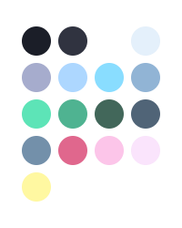
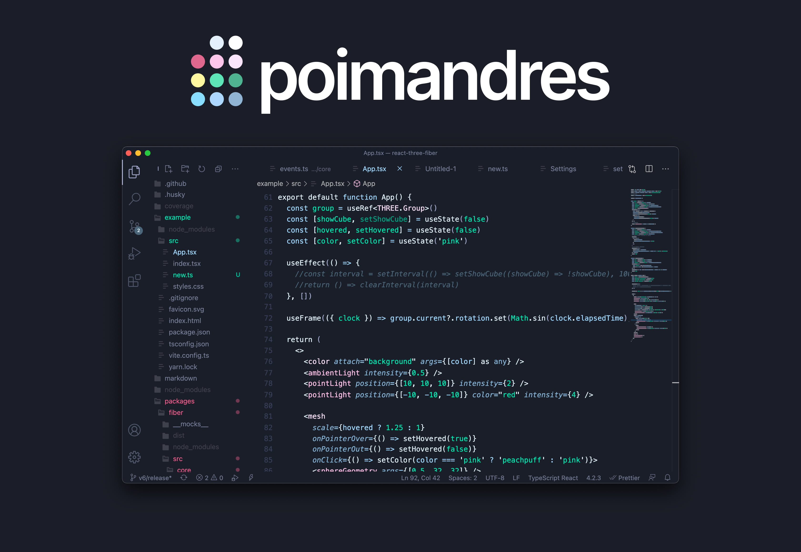
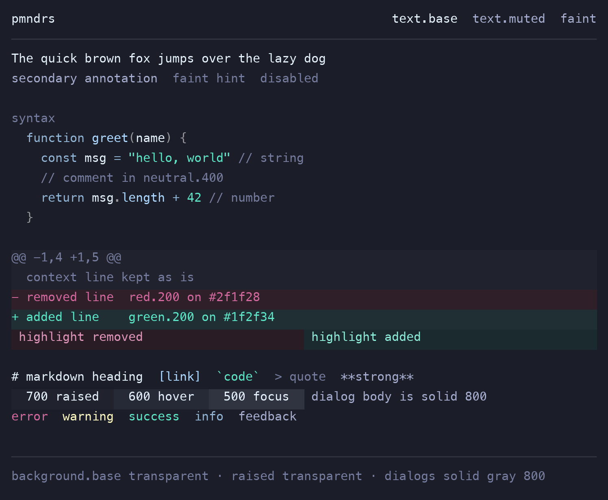

<p align="middle">
  
  
</p>

Poimandres is a minimal, frameless dark-theme inspired mostly by [blueberry](https://github.com/peymanslh/vscode-blueberry-dark-theme). This theme tries to focus on semantic meaning instead of color variety. You'll find that it colors things like errors, voids, throws and deletes in red, types are slighty darker so that the spotlight is on the code, green new's, etc.

The screencap above uses the following settings:

```json
{
  "workbench.colorTheme": "poimandres",
  "workbench.iconTheme": "quill-icons-minimal",
  "workbench.productIconTheme": "icons-carbon",
  "editor.renderIndentGuides": false,
  "editor.renderWhitespace": "none",
  "editor.minimap.renderCharacters": false,
  "editor.fontSize": 13.5,
  "editor.fontFamily": "Menlo",
  "window.zoomLevel": 0.5,
}
```

#### Contribute

    git clone https://github.com/drcmda/poimandres-theme
    cd poimandres-theme
    npm install
    npm run dev

Go to `Run and Debug`, click the ▶ icon, any change you make in `src/theme.js` will now be reflected when you save.

## Related

- [poimandres-alacritty][poimandres-alacritty]: Alacritty version
- [poimandres-iterm][poimandres-iterm]: Iterm version
- [poimandres-kitty][poimandres-kitty]: Kitty version
- [poimandres-nvim][poimandres-nvim]: Neovim version
- [poimandres-jetbrains][poimandres-jetbrains]: JetBrains version

[poimandres-alacritty]: https://github.com/z0al/poimandres-alacritty
[poimandres-iterm]: https://github.com/alii/poimandres-iterm
[poimandres-kitty]: https://github.com/guilhermedeandrade/poimandres-kitty
[poimandres-nvim]: https://github.com/olivercederborg/poimandres.nvim
[poimandres-jetbrains]: https://github.com/marko-mihajlovic/poimandres-jetbrains

### Hyper theme

```bash
hyper i hyper-pmndrs
```

### OpenCode theme

The [OpenCode](https://opencode.ai) TUI theme lives in [`opencode/pmndrs.json`](opencode/pmndrs.json). Copy it into your global themes directory:

```bash
cp opencode/pmndrs.json ~/.config/opencode/themes/
```

The filename is the theme name, so select `pmndrs` in `~/.config/opencode/cli.json` (or run `/themes`):

```json
{
  "theme": {
    "name": "pmndrs",
    "mode": "dark"
  }
}
```

Only `background.base` is transparent, so the transcript sits on your own terminal background. Everything drawn on top of it — prompt box, tab strip, menus, dialogs, toasts, code blocks — uses the solid `raised` ramp (gray 800 / 700 / 600). OpenCode has no separate menu token: right-click menus and the prompt box read the same ramp, so they cannot be styled apart — a menu is only solid if the prompt box is. Dialogs and pickers additionally go through `@dialog`, which pulls the focus fill to neutral.500 and keeps light text on the active row.



The sample above is 80x24 and generated from the theme file, so it stays honest when the palette changes:

```bash
npm run opencode:preview          # prints it with truecolor escape codes
node opencode/preview.mjs         # same thing, any theme file: node opencode/preview.mjs other.json
```
